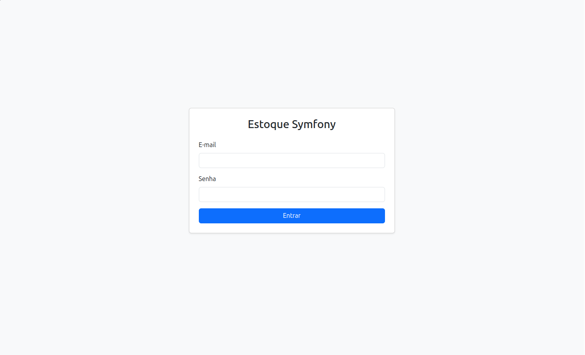
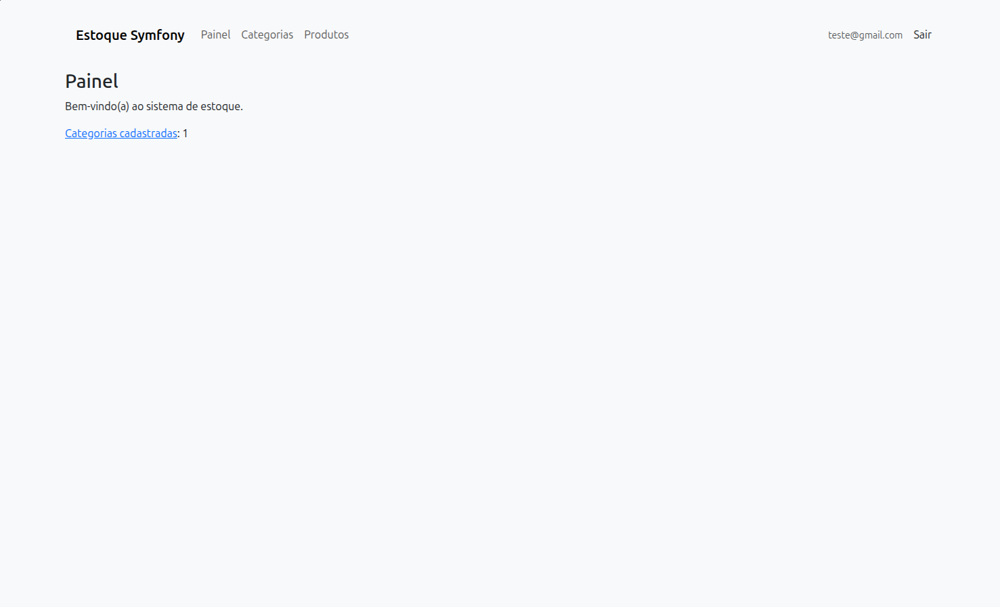
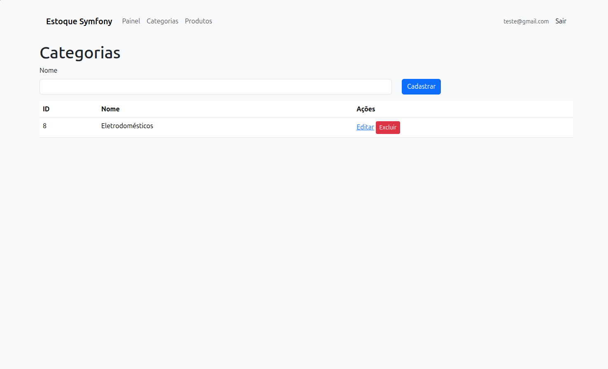
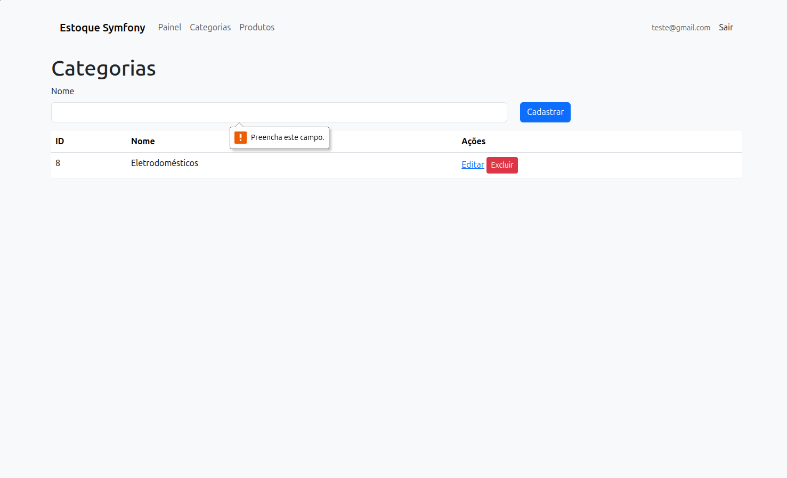
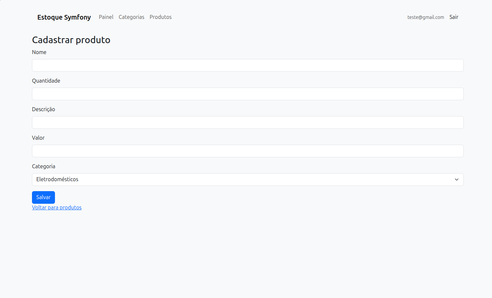
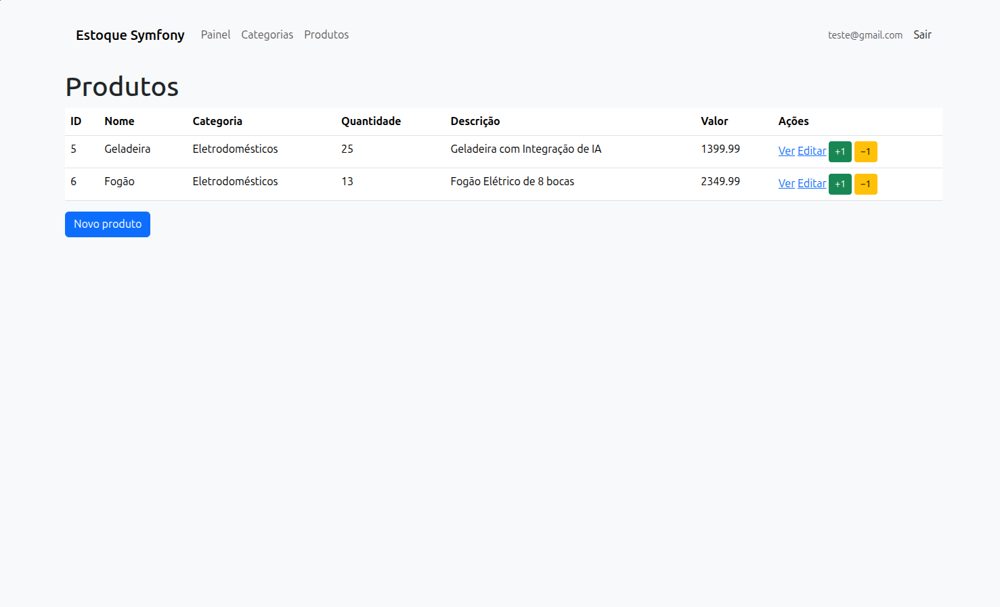
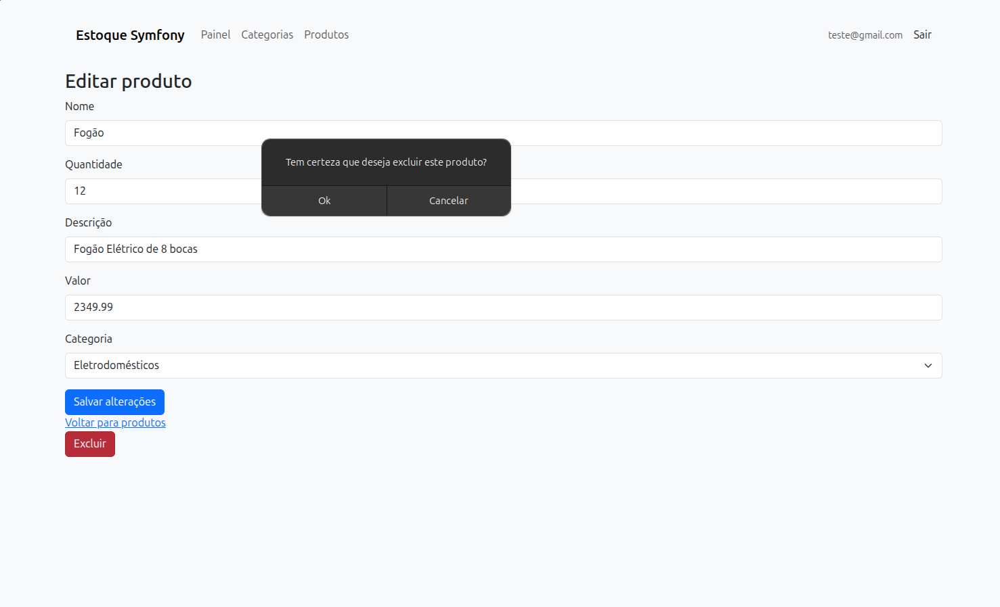

# Sistema de Estoque com Symfony

Aplicação web simples para gerenciamento de categorias e produtos, com controle de entrada e saída de estoque.

## Funcionalidades

- Login com usuário armazenado no banco de dados.
- Cadastro, listagem, edição e exclusão de categorias.
- Cadastro, listagem, edição e exclusão de produtos.
- Ações para adicionar ou remover uma unidade do estoque.
- O estoque não pode ficar negativo.

## Tecnologias

- PHP 8.4 ou superior
- Symfony 8.1
- MySQL
- Doctrine ORM e Migrations
- Twig e Bootstrap

## Requisitos

- PHP 8.4 ou superior, com extensão `pdo_mysql`
- Composer
- MySQL
- Symfony CLI (opcional, recomendado para iniciar o servidor local)

## Como executar

Clone o repositório e acesse a pasta:

```bash
git clone https://github.com/ezeepires/estoque-symfony.git
cd estoque-symfony
```

Instale as dependências e crie o arquivo de configuração local:

```bash
composer install
cp .env.example .env
```

Edite o `.env` e configure `DATABASE_URL` com o usuário, a senha e a versão do seu MySQL. O banco utilizado pelo projeto é `estoque_symfony`. Preencha também `APP_SECRET` com um valor aleatório. Para gerar um valor, você pode executar:

```bash
php -r "echo bin2hex(random_bytes(32)), PHP_EOL;"
```

Com o MySQL iniciado, crie o banco e execute as migrations:

```bash
php bin/console doctrine:database:create
php bin/console doctrine:migrations:migrate
php bin/console importmap:install
```

### Criar o primeiro usuário

Gere o hash da senha:

```bash
php bin/console security:hash-password
```

Copie o hash gerado e insira o usuário na tabela `usuario`, substituindo o e-mail e o hash:

```sql
INSERT INTO usuario (email, roles, password)
VALUES ('admin@exemplo.com', '["ROLE_USER"]', 'COLE_AQUI_O_HASH_GERADO');
```

Inicie o servidor local:

```bash
symfony server:start
```

Acesse `http://localhost:8000/login` e entre com o e-mail e a senha definidos para o usuário.

## Telas da aplicação

### Login



### Painel



### Categorias





### Produtos




### Estoque





